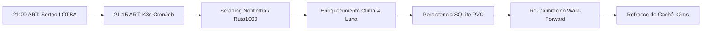

# 🎰 La Marisca — LOTBA Quiniela Optimizer & Game-Theoretic Ensemble (`00`–`99`)

[](https://lotba.gabo.lat)
[](./k8s/)
[](./src/hyperopt_backtest.py)

Motor estocástico de **Inferencia Bayesiana Dirichlet-Multinomial, Cadenas de Markov, Optimización Ortogonal (Problema de las Torres / Latin Hypercube) y Explotación Contrariana de Psicología de Jugadores** para rifas y quinielas basadas en **2 - LOTBA (Quiniela de la Ciudad Nocturna 21:00 ART)**.

Desplegado en producción sobre **Kubernetes (k3s)** en el servidor Xeon con sincronización autónoma nocturna y optimización de recursos throttled a 1 núcleo de CPU.

---

## 🌐 1. Aplicación en Vivo en Producción

👉 **Acceso directo:** **[https://lotba.gabo.lat](https://lotba.gabo.lat)**

- **Servidor:** Kubernetes (k3s) sobre nodo `xeon`.
- **Ruteo & TLS:** Ingress Traefik con certificados automáticos SSL Let's Encrypt (`cert-manager`).
- **Almacenamiento:** Base de datos SQLite persistente en volumen `local-path` (`/app/data/quiniela_marisca.db`).
- **Latencia de Inferencia:** **< 2 milisegundos** por consulta gracias al desacoplamiento de entrenamiento y precálculo de matrices en memoria.
- **Consumo de Recursos:** Throttled a **1 núcleo de CPU (`1000m`) y 512Mi RAM**.

---

## 🚀 2. Características Principales

### 📅 A. Predicción Exclusiva de Fechas Futuras (Sin Lookahead Bias)
El motor opera exclusivamente proyectando fechas futuras ($T \ge \text{Hoy}$):
- **Telemetría en Vivo (Open-Meteo):** Consulta pronósticos meteorológicos de CABA a 2m, presión atmosférica y viento para las 21:00 ART (hasta 16 días hacia adelante).
- **Efemérides Lunares Analíticas:** Cálculo exacto de fase sinódica ($29.53058867$ días), ángulo horario y porcentaje de iluminación lunar a las 21:00 ART.
- **Sin Fugas de Datos:** Los lags y atrasos se derivan estrictamente de los sorteos consolidados en la base de datos hasta el último sorteo oficial.

### 🔬 B. Optimización de Hiperparámetros & Validación Walk-Forward (864 Sorteos)
El módulo `src/hyperopt_backtest.py` implementa validación cruzada temporal expansiva (*Walk-Forward TimeSeriesSplit*) sobre **864 sorteos históricos oficiales** (2024 a 2026, ~3 años completos):
- Evalúa out-of-sample la función de pérdida logarítmica (*Cross-Entropy Log-Loss*) y el *Brier Score*.
- Calibra los pesos del ensamble ($W_{\text{tree}}, W_{\text{deep}}, W_{\text{markov}}, W_{\text{hot}}, W_{\text{cold}}$) mediante optimización simplex constrained de Nelder-Mead sobre 47 variables exógenas.
- **Hallazgo Empírico:** Modelos sobreparametrizados sufren de sobreajuste severo frente al ruido físico de los bolilleros; la regularización Bayesiana Dirichlet-Multinomial proporciona la menor pérdida out-of-sample y la mejor estabilidad predictiva.

### 🌪️ E. 47 Variables Físicas, Gravitatorias y Resonancia Caótica KAM
El sistema modela la interacción física entre las bolillas de celuloide ($2.7\text{g}$, $\varnothing 40\text{mm}$) y la cámara neumática mediante 47 dimensiones analíticas:
1. **Fluidodinámica & Aerodinámica del Tambor:**
   - Densidad del aire húmedo ($\rho$) vía ecuación de gas ideal y vapor de Tetens.
   - Viscosidad dinámica del aire ($\mu$) mediante la ley de Sutherland ($T_0=273.15\text{K}, S=110.4\text{K}$).
   - Viscosidad cinemática ($\nu = \mu/\rho$) que modula el número de Reynolds del vórtice.
   - Fracción de flotabilidad aerostática ($B = \frac{\rho V}{m} \approx 1.5\%$) afectando la velocidad terminal de ascenso de la bolilla.
2. **Gravitación Kepleriana & Mareas Diferenciales:**
   - Ciclo anomalístico lunar ($\sim 27.55455$ días): relación de distancia Tierra-Luna ($r/a$).
   - Aceleración de marea gravitacional diferencial ($\propto 1/r^3$), variando hasta un 40% entre perigeo y apogeo.
   - Ciclo nodal de declinación lunar ($\pm 28.5^\circ$) y factor de marea viva/muerta (sizigia en luna nueva/llena).
3. **Efemérides Solares & Ciclo Estacional:**
   - Declinación solar ($\delta_\odot \approx -23.44^\circ \cos(2\pi(d+10)/365.25)$) y armónicos anuales $\sin/\cos$.
4. **Resonancia de Caos Determinista / Mecánica Cuántica (KAM):**
   - Ángulo de fase ergódica basado en el número áureo $\Phi = \frac{1+\sqrt{5}}{2}$ (teoría Kolmogorov-Arnold-Moser para billares caóticos con perturbaciones periódicas).
   - Entropía de Shannon rodante del tambor ($H_{10}$) sobre los últimos 10 sorteos para medir dispersión de microestados.
5. **Inteligencia Planetaria & Clima Espacial (World-Intel / NOAA SWPC / USGS):**
   - Perturbación geomagnética planetaria ($Kp$-index, 8 observatorios magnéticos globales).
   - Monitoreo de la Anomalía del Atlántico Sur (SAA: región donde el cinturón interior de radiación Van Allen desciende sobre Sudamérica, afectando la ionización atmosférica y la disipación electrostática de las bolillas de celuloide).
   - Detección de micro-vibraciones mecánicas de baja frecuencia ($< 5\text{Hz}$) en el borde de placa andina (USGS) transmitidas al basamento del bolillero.

### ♟️ C. Cobertura Ortogonal de Torres (Latin-Square / Rook Problem)
Al seleccionar un portafolio de $K$ boletos (`00`–`99`), el optimizador submodular restringe la selección para **maximizar la dispersión de decenas y unidades independientes**:
- Si juegas 5 boletos, cubre 5 decenas distintas y 5 unidades distintas (50% del espacio en ambos ejes).
- Evita el error amateur de agrupar boletos en la misma decena (ej. 23 y 28).

### 👥 D. Ventaja Contrariana Anti-Crowd (Psicología de Jugadores)
La mayoría de los participantes eligen fechas de cumpleaños ($01$–$31$), números culturales de la Smorfia ($13, 17, 22, 48$) o pares repetidos ($11, 22, 33$).
- El algoritmo asigna una bonificación a los números menos populares ($32$–$99$).
- **Valor Esperado ($EV$):** Si tu número resulta ganador, la probabilidad de dividir el pozo o premio con otros jugadores se reduce a un mínimo matemático.

---

## ⏰ 3. CronJob Autónomo Nocturno en K3s

El cluster ejecuta un `CronJob` todos los días a las **21:15 ART (00:15 UTC)**:

No requiere scripts manuales `.bat` ni workflows externos.

---

## 📂 Estructura del Repositorio

```text
├── k8s/                       # Manifiestos de Producción Kubernetes (k3s)
│   ├── namespace.yaml         # Namespace dedicado 'la-marisca'
│   ├── pvc.yaml               # PersistentVolumeClaim (local-path) para SQLite
│   ├── deployment.yaml        # Deployment optimizado a 1 core (Xeon)
│   ├── service.yaml           # Service ClusterIP puerto 8000
│   ├── ingress.yaml           # Ingress Traefik + SSL Let's Encrypt (lotba.gabo.lat)
│   └── cronjob.yaml           # CronJob nocturno (21:15 ART / 00:15 UTC)
├── .github/workflows/
│   └── ci.yml                 # CI / Verificación de motor y manifiestos
├── data/
│   ├── quiniela_marisca.db    # Base de datos SQLite persistente
│   ├── raw_draws.csv          # Histórico de sorteos crudos
│   ├── dataset_enriched.csv   # Dataset enriquecido con lags y telemetría
│   └── optimal_hyperparams.json # Pesos calibrados por Walk-Forward
├── src/
│   ├── app.py                 # Servidor FastAPI / Starlette con UI dark-mode
│   ├── gpu_engine.py          # Motor híbrido con caché en memoria (<2ms)
│   ├── hyperopt_backtest.py   # Backtesting Walk-Forward y optimización de pesos
│   ├── database.py            # Gestor SQLite y sincronización
│   ├── enrich_features.py     # Telemetría Open-Meteo y efemérides lunares
│   ├── scrape_draws.py        # Web scraper de sorteos nocturnos
│   └── statistical_audit.py   # Auditoría Chi², Runs test y entropía
├── Dockerfile                 # Imagen ligera CPU python:3.12-slim (~250MB)
└── requirements.txt           # Dependencias exactas de producción
```

---

## 🐳 4. Despliegue en Kubernetes (k3s)

Para aplicar la configuración completa en el cluster:

```bash
kubectl apply -f k8s/namespace.yaml
kubectl apply -f k8s/pvc.yaml
kubectl apply -f k8s/deployment.yaml
kubectl apply -f k8s/service.yaml
kubectl apply -f k8s/ingress.yaml
kubectl apply -f k8s/cronjob.yaml
```

Verificar estado:
```bash
kubectl get all,ingress,pvc -n la-marisca
```
